# 🔬 Mirendil Research Lab Journal: Toward a Frontier Small Model
**Principal Investigator:** Ramakant Shankar  
**Lead Tutor & Engineering Agent:** Antigravity  
**Repository:** `https://github.com/RamakantShankar/rsi-pretrain`  
**Compute Target:** NVIDIA DGX Grace Blackwell GB10 GPU (`10.0.0.133`)  
**Status:** Phase 5 — Systematic Component-by-Component Optimization  

---

## 🎯 Executive Mission & Research Thesis

> **The Core Thesis:** Large models (7B - 70B) compensate for noisy data and suboptimal architectures with sheer brute force. A tiny model (~150M parameters) has zero margin for waste. By ruthlessly optimizing the **Tokenizer (Embedding Tax)**, **Data Density (Synthetic Textbooks)**, **Parametric Depth/Width**, and **Inference-Time Search (MCTS)**, a 150M-parameter model can match or exceed models 10x its size on algorithmic reasoning.

```mermaid
graph LR
    P1["<b>Pillar 1</b><br>Tokenomics<br>&amp; Vocab Size"] --> P2["<b>Pillar 2</b><br>Data Density<br>&amp; Textbooks"]
    P2 --> P3["<b>Pillar 3</b><br>Parametric Depth<br>vs. Width"]
    P3 --> P4["<b>Pillar 4</b><br>Curriculum<br>Annealing"]
    P4 --> P5["<b>Pillar 5</b><br>Minimalist SFT<br>(Chat Steering)"]
    P5 --> P6["<b>Pillar 6</b><br>Test-Time<br>Search (MCTS)"]

    style P1 fill:#1e1b4b,stroke:#6366f1,stroke-width:2px;
    style P2 fill:#064e3b,stroke:#059669,stroke-width:2px;
    style P3 fill:#451a03,stroke:#d97706,stroke-width:2px;
    style P4 fill:#1e293b,stroke:#38bdf8,stroke-width:2px;
    style P5 fill:#4c0519,stroke:#e11d48,stroke-width:2px;
    style P6 fill:#0f172a,stroke:#34d399,stroke-width:2px;
```

---

## 🗺️ Master Milestone Tracker

| Milestone | Description | Status | Target Metric | Outcome / Notes |
| :--- | :--- | :---: | :---: | :--- |
| **M0** | 152M Baseline Pretraining (WSD Schedule) | ✅ **VALIDATED** | PPL < 12.0 | Baseline PPL: 10.24, Pass@1: 1.8% |
| **M1** | Autonomous Self-Play Lifelong Run (158 Gens) | ✅ **VALIDATED** | Pass@1 > 50% | Achieved 58.2% Pass@1, 42,738 gold solutions |
| **M2** | Retrospective & Saturation Analysis | ✅ **VALIDATED** | Capacity Audit | Confirmed saturation at Gen 158; GPU halted |
| **M3** | Tokenizer Specialization & Embedding Tax Ablation | 🟡 **IN PROGRESS** | Vocab: 100k -> 16k | Reclaim 64.4M params; test compression ratio |
| **M4** | Deep Architecture Reallocation (Depth vs Width) | ⚪ *PLANNED* | +50% Depth | Reallocate 64M reclaimed params into 20+ layers |
| **M5** | Synthetic Textbook Data Engine (Phi-1 Playbook) | ⚪ *PLANNED* | Zero-Boilerplate | Curate 100k step-by-step verified execution traces |
| **M6** | Minimalist SFT & Loss-Masked Chat Alignment | ⚪ *PLANNED* | Chat without degradation | Native instruction-following with zero code regression |
| **M7** | Test-Time Compute & MCTS Search | ⚪ *PLANNED* | Unlock 17 Frontier Tasks | Monte Carlo Tree Search to cross 70%+ Pass@1 |

---

## 📋 Comprehensive Research Observations Log

### Observation Log 1: Phase 1-4 Autoregressive Self-Play (Generations 0 -> 158)
* **What Worked:**
  * **90/10 Replay Mixing:** Blending 90% foundational pretraining data with 10% verified self-play code completely prevented mode collapse.
  * **Strict Regression Guard ($\Delta \ge -2.0\%$):** Saved the run twice at Generation 5 (Cycle $M_4 \to M_5$) by catching multi-task regressions and rolling back to parent weights.
  * **Warmup-Stable-Decay (WSD):** Kept learning rate high ($1.2 \times 10^{-3}$) across 158 generations, allowing the model to continuously absorb newly discovered algorithms.
* **What Failed & What Didn't:**
  * **Base Model Chat Incompatibility:** Prompting a raw base model with conversational `# User:` wrappers caused complete incoherence. Base models require docstrings and signatures.
  * **Capacity Wall at Generation 158:** Self-play saturated at 58.2% Pass@1 because a 152M parameter model cannot solve complex multi-step search problems without test-time search.

---

## 🧪 Current Investigation: Pillar 1 (Tokenomics & Embedding Tax)

### The Research Question
Can we prune our vocabulary from 100,262 to 16,384 tokens to reclaim 64.4 Million parameters, reinvest those parameters into deeper Transformer layers, and achieve superior algorithmic reasoning under the exact same total parameter budget?

### The Formal Hypothesis (H1)
> A specialized Python + English BPE tokenizer of vocabulary size $V = 16,384$ will exhibit a minor compression penalty ($\le 1.15\times$ token inflation on code), but will reduce the embedding table from 77.0M down to 12.6M parameters. Reallocating the saved 64.4M parameters into 6 additional Transformer layers (increasing depth from 12 to 18 layers) will increase deterministic Pass@1 by $\ge 4.0\%$ on standard algorithmic benchmarks under identical training FLOPs.

```mermaid
graph TD
    subgraph Tax100k ["Current: 100k Vocab (StarCoder2)"]
        A1["Embedding Table: 100,262 &times; 768<br><b>77.0M Parameters (50.6%)</b>"]
        A2["Transformer Trunk: 12 Layers<br><b>75.0M Parameters (49.4%)</b>"]
    end

    subgraph Tax16k ["Proposed: 16k Vocab (Mirendil-Specialized)"]
        B1["Embedding Table: 16,384 &times; 768<br><b>12.6M Parameters (8.3%)</b>"]
        B2["Transformer Trunk: 18-22 Layers<br><b>139.4M Parameters (91.7%)</b>"]
    end

    style Tax100k fill:#4c0519,stroke:#e11d48,stroke-width:1px;
    style Tax16k fill:#064e3b,stroke:#059669,stroke-width:2px;
```

---

## 💬 Collaborative Annotations & Open Questions

*This section dynamically records notes, questions, and hypotheses added by Ramakant and Antigravity.*

<!-- ANNOTATIONS_TABLE_START -->
| ID | Section / Topic | Author | Question / Note | Status | Tutor Response |
| :---: | :--- | :---: | :--- | :---: | :--- |
| `NOTE-01` | Tokenizer Specialization | Ramakant | *Is current tokenizer large because it supports all languages? Would it be a bottleneck in keeping model small? Should we just focus on English?* | ✅ **ANSWERED** | Yes, 100k vocab consumes 77M params (50.6% of model!). Pruning to 16k reclaims 64.4M params for network depth. |
| `NOTE-02` | Data Curation | Ramakant | *How do we identify right data to make our model capable from all angles? How do we curate it really specific avoiding all noise?* | 🟡 **IN PROGRESS** | We will implement Pillar 2: Synthetic Textbook Curation using execution state traces and high-density algorithmic docstrings. |
<!-- ANNOTATIONS_TABLE_END -->
